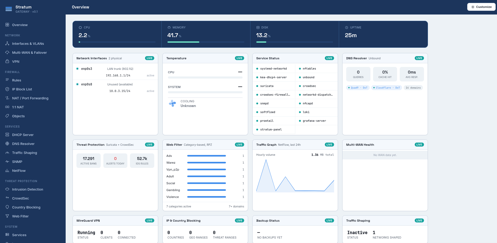
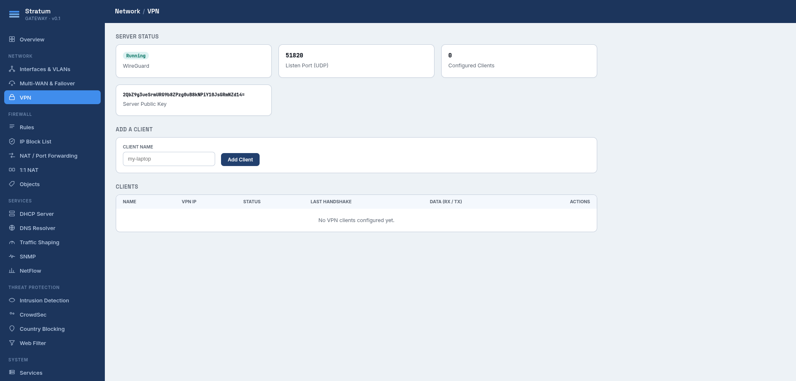
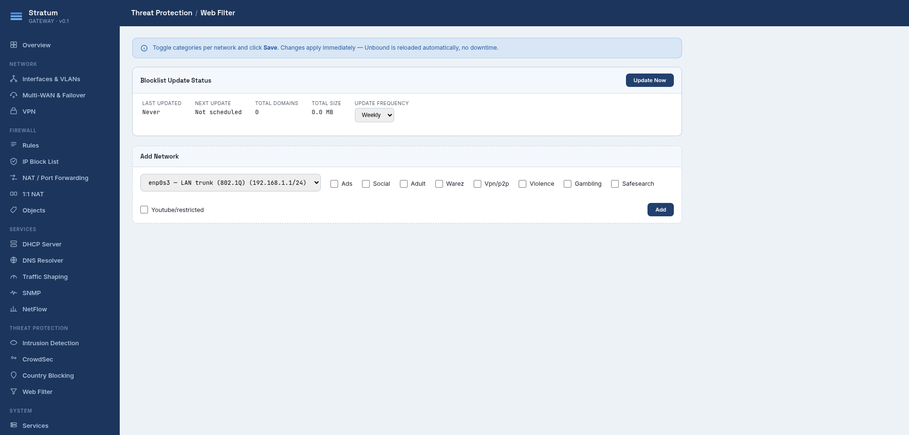
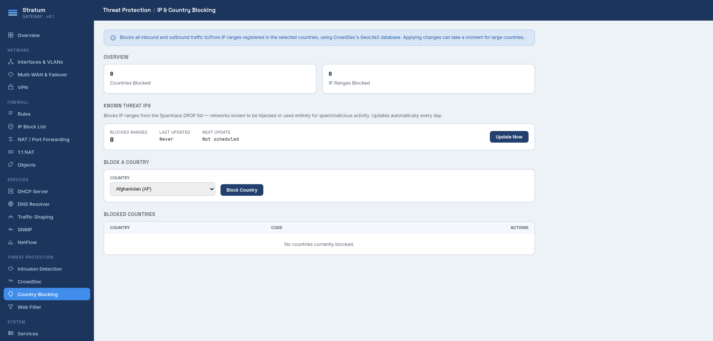
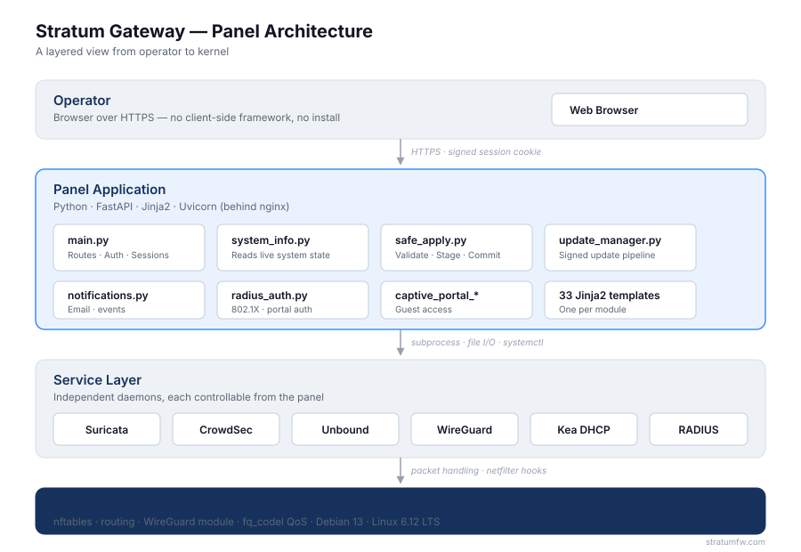

# Stratum Gateway — Web Panel

The management interface for **Stratum Gateway**, an enterprise-grade, self-hosted firewall and network security platform. This repository contains the Python/FastAPI backend and Jinja2 templates that power the panel's UI.

> **Repository status:** Private. This is the source snapshot for the Stratum Gateway management panel. It is not yet publicly distributed.

---

## What this is

The panel is a single-process web application that exposes every configuration surface of the gateway through a browser-based interface. It talks to the underlying system — nftables, Suricata, CrowdSec, Unbound, WireGuard, and the rest — through a combination of direct file access, CLI tool invocation, and systemd service management.

There is no cloud component. The panel runs on the same machine as the gateway, bound to a local interface, and authenticates users against a local credential store.

---

## Technology stack

| Layer | Component |
|---|---|
| Language | Python 3 |
| Web framework | FastAPI |
| ASGI server | Uvicorn (behind nginx) |
| Templating | Jinja2 |
| Sessions | Starlette SessionMiddleware (signed cookies) |
| Password hashing | bcrypt |
| System integration | `subprocess`, `nftables` CLI, systemd |
| Frontend | Server-rendered templates, vanilla JavaScript |

No JavaScript framework. No client-side build step. No database — state lives in files under `/etc/` and `/var/lib/`.

---

## Screenshots

The four interactive demo pages published on [stratumfw.com](https://stratumfw.com/try-me/) render the actual panel templates with mock data. They provide an honest preview of the UI:

### Dashboard

The default view — system vitals, interface status, live security events, and configurable widgets.

### WireGuard VPN

Peer management, key provisioning, QR code generation for mobile clients, and live connection status.

### Web Filtering

Category-based DNS filtering with a curated feed catalog, per-feed scope, and scheduled updates.

### Geo & Threat Blocking

Country-level blocking plus a continuously refreshed threat IP list aggregated from public intelligence feeds.

---

## Architecture

The panel is a single Python process layered between the operator's browser and the Linux kernel. Every configuration change flows through a validated pipeline before it reaches nftables, systemd, or the underlying service daemons.

### Layers, briefly

- **Operator** — any modern browser. HTTPS only, signed session cookie, no client-side framework.
- **Panel application** — FastAPI + Uvicorn, with Jinja2 server-rendered templates. `system_info.py` reads live state; `safe_apply.py` orchestrates changes; `update_manager.py` handles signed updates.
- **Service layer** — Suricata, CrowdSec, Unbound, WireGuard, Kea DHCP, RADIUS. Independent daemons, each controlled from the panel through subprocess calls and systemd.
- **Kernel** — nftables, routing, the WireGuard kernel module, and fq_codel QoS. All packet handling happens here at line rate.

---

## Repository layout
