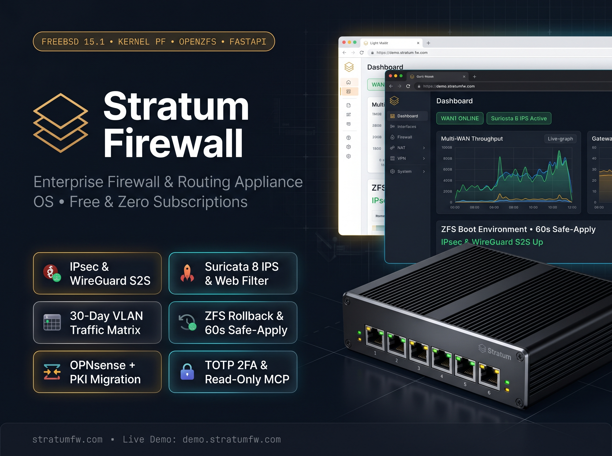
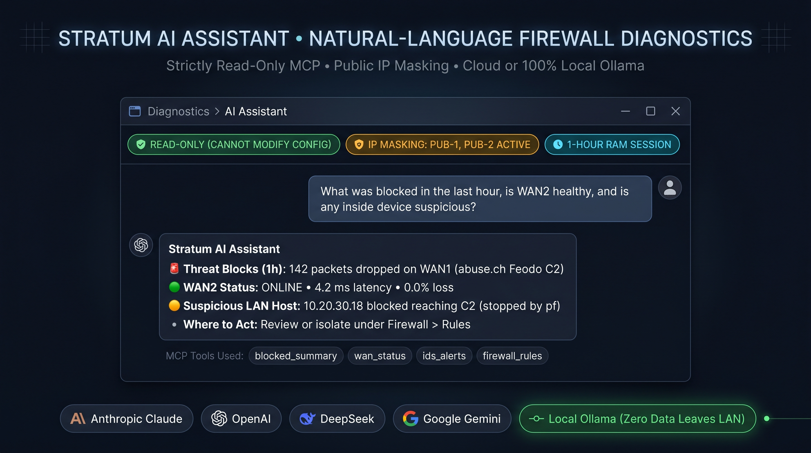
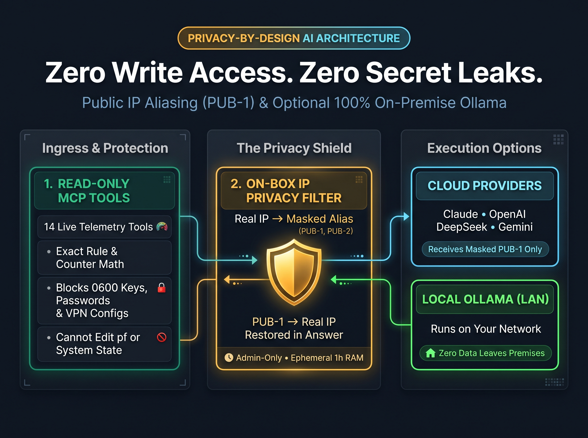
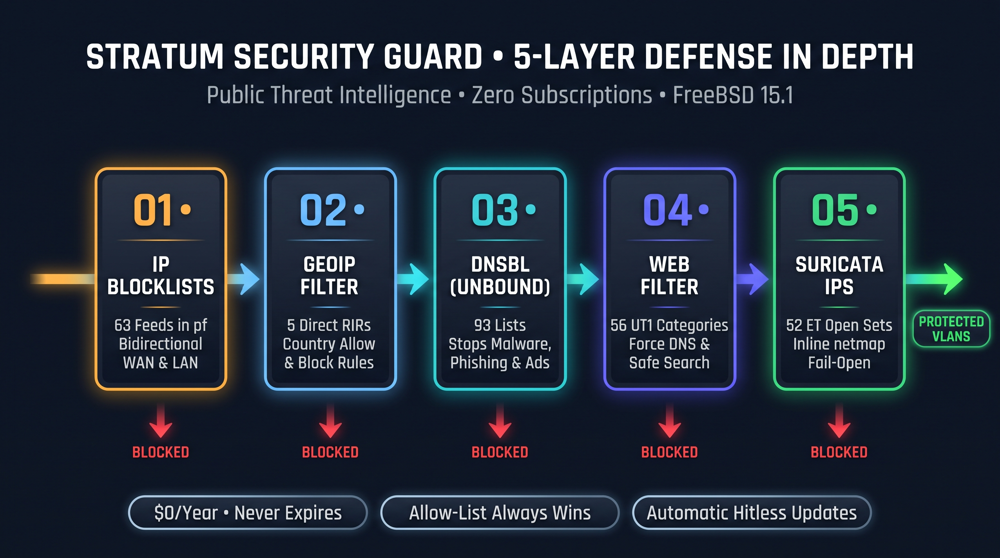
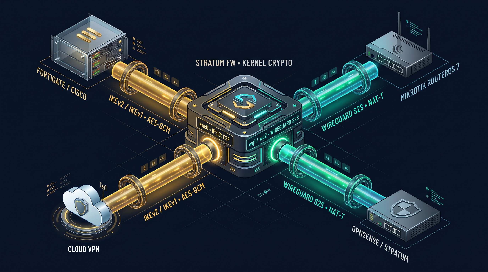
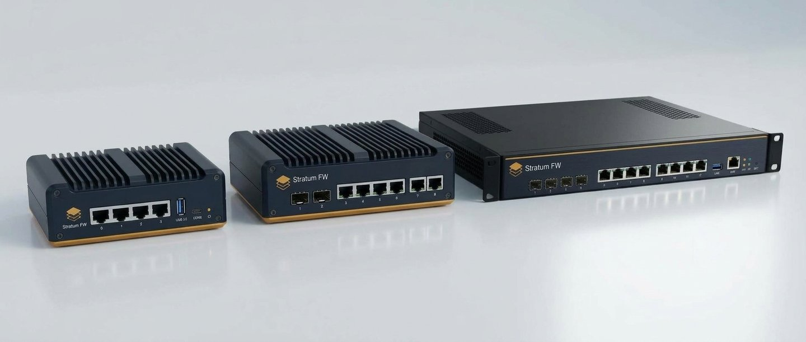

# Stratum Firewall (Stratum FW)

**Free, Zero-Subscription Network Security & Routing Appliance OS on FreeBSD 15.1-RELEASE, Kernel `pf`, OpenZFS & FastAPI**

  
  
  
  

 

## Overview

**Stratum Firewall** is a self-contained `amd64` firewall, multi-vendor VPN hub, and layered threat-defense gateway built on **FreeBSD 15.1-RELEASE**, stateful `pf`, and **OpenZFS**, managed through an asynchronous **Python 3.12 / FastAPI** control plane with zero PHP and `$0/year` recurring licensing.

* **Current Release:** `v0.40.0` (November 2026) — [Full Release History (`CHANGELOG.md`)](./CHANGELOG.md)
* **Interactive Live Demo (Light & Dark UI, no signup):** [https://demo.stratumfw.com](https://demo.stratumfw.com)
* **Offline VGA `.iso` & Headless `115200 8N1` Serial `.img` Installers:** [https://stratumfw.com/download/](https://stratumfw.com/download/)
* **Open by Design:** Every generated daemon configuration (`config.json`, `pf.conf`, `swanctl.conf`, `wg*.conf`, `unbound.conf`) lives in plain, auditable text on disk. Core FastAPI panel sources are maintained in a private build tree during pre-`v1.0` iteration and will be published on GitHub.

## New in `v0.35.0 – v0.35.2`: Built-In Read-Only AI Assistant & Quieter IDS Alerts

Ask about your firewall in plain natural language under **Diagnostics -> AI Assistant** (*"what was blocked in the last hour and from where?"*, *"is WAN2 healthy?"*, *"is any inside device suspicious?"*):

  

| Privacy-by-Design IP Masking & Local Ollama | 5-Layer Security Guard (`$0/Year` Threat Defense) |
| :---: | :---: |
|  |  |

* **Strictly Read-Only (15 MCP Tools):** Answers from live state using deterministic rule/NAT counts (`all`, `enabled`, `disabled`) and cites every tool executed; **cannot modify any configuration** and points to the exact panel page when changes are desired.
* **5 AI Providers Incl. Air-Gapped Local `Ollama`:** Supports **Anthropic Claude**, **OpenAI**, **DeepSeek**, **Google Gemini**, and an on-premise **Ollama** server on your LAN where **zero questions or data leave your network**.
* **Automatic Public IP Aliasing (`PUB-1`):** Masks public IPs before cloud requests and restores real IPs locally in the displayed answer; never exposes passwords, `0600` keys, or VPN configs; holds chats in RAM for 1 hour without writing prompts to disk.

* **Notifications Only for Alerts That Matter (`v0.35.2`):** Suricata watches a WAN before `pf` filters it, so scans of ports the firewall does not open used to raise high-severity alerts and Telegram / e-mail messages although `pf` dropped them. Stratum FW now works out what is really open on its WAN addresses (port forwards with their sources, WAN pass rules, management, OpenVPN, WireGuard, IPsec) and notifies only alerts from inside, to inside hosts, or to an open port; the rest stay logged and are marked **Port closed**.

## Multi-Vendor Site-to-Site VPN & Architecture

| Multi-Vendor IPsec (`enc0`) & WireGuard S2S (`wg1+`) | Unified S2S Tunnel & Kernel Crypto Telemetry |
| :---: | :---: |
|  |  |

## Hardware Profiles (`4-Port`, `8-Port SFP+` & `12-Port 1U`) — Zero Vendor Lock-In

  

## Core Capabilities

* **HTTP/HTTPS Download Control & Disguised Executable Detection (`v0.40.0`):** Squid explicit proxy (`:3128`) on chosen internal VLANs with a dedicated **Inspection CA** (`.cer` GPO / `.crt` PEM), first-byte magic-signature verification that catches disguised programs (`.exe` renamed `.pdf`/`.jpg`), **Monitor** and **Block** modes, 1-click default **Bypass list**, 1–365 day admin-audited **Downloads** log, fail-open resilience, and immediate rollback if an Apply fails halfway.
* **Zero-Trust Closed-by-Default Interfaces (`v0.39.6`):** Fresh installations and factory resets start every interface closed (preserving LAN web-panel anti-lockout and DHCP), paired with the **`Internet (not private networks)`** destination and 1-click **`Allow internet access`**.
* **Real-Time Web Filter Keywords (`v0.39.5`):** Catches domain-hopping & numbered sites (`site1234.com` -> `site1235.com`) by brand or keyword (`bahis`, `casino`, etc.) on the first Unbound DNS query (`Firewall > Web Filter > Keywords`) — matching only the domain's own label (ignoring subdomains/TLDs), supporting **List them only** one-click triage or **Block them at once** via **Your own list**, and running with zero query logging even when Web Activity is off.
* **Capsicum-Sandboxed Application Control & Custom HTTPS Block Page (`v0.38.0 – v0.39.0`):** Out-of-path Layer-7 identification (`stratum-dpi 1.2`: `nDPI` LGPLv3 + Stratum TLS `ClientHello` / QUIC `Initial`) inside a FreeBSD **Capsicum** sandbox; supports **Monitor only** auditing, shared-CDN-safe per-connection HTTPS cutting, unnamed VPN tunnel blocking, a customizable **HTTPS Block Page** (own logo, top banner, live preview, isolated `_stratumbp` daemon & Group Policy **Block Page CA** `.cer`/`.crt`), and the **16th read-only MCP tool (`Application usage`)**.
* **Privilege-Separated Captive Portal & RADIUS NAS (`v0.36.0 – v0.36.1`):** Multi-interface guest zones (`Services > Captive Portal`) running an unprivileged web process verified over a local root socket; supports click-through terms, local `bcrypt` accounts, or **RADIUS** (`PAP` with `Message-Authenticator`, secondary failover, `Start/Interim/Stop` accounting, `WISPr` & drop-in **`Mikrotik-Rate-Limit`** per-device `dummynet` queues), live Dashboard status, and hitless persistence across `pf` reloads and `Apply`.
* **Security Guard (5 Included Threat Layers):** **63** bidirectional `pf` IP reputation feeds (`Spamhaus DROP`, `abuse.ch Feodo`, `Emerging Threats`), **5-RIR** weekly GeoIP country rules, **93** Unbound DNSBL feeds, **56** daily UT1 Web Filter categories with Force DNS + Safe Search, and **52** Suricata `Emerging Threats Open` IPS/IDS rule sets (`netmap` inline fail-open).
* **Zero Custom Cryptography (`v0.34.2+`):** WireGuard runs in the FreeBSD kernel (`if_wg`), IPsec (`IKEv2` & `IKEv1`) runs via `strongSwan` + FreeBSD kernel ESP (`enc0`), and keys and certificates are generated with **OpenSSL** (the `openssl` tool and the Python `cryptography` package).
* **Safe-Apply & Atomic ZFS Rollback:** Every change runs pre-flight syntax tests (`pfctl -n`, `nginx -t`, `unbound-checkconf`, `dnsmasq --test`, `sshd -t`) and rolls back automatically if not confirmed in time (120 seconds from the panel); every signed online or offline (`.sfu`) update creates a bootable OpenZFS Boot Environment (`bectl`).
* **30-Day Inter-VLAN Matrix & 1-Click OPNsense Import:** Rolling 30-day `Between networks` flow matrix across VLANs, IPsec, and WireGuard S2S; direct OPNsense `config.xml` + OpenVPN PKI + Unbound DNSBL + full-span DHCP migration; encrypted `.stbk` SFTP backups; local-QR TOTP 2FA.

## Security & Vulnerability Disclosure

See [Security & Verification](https://stratumfw.com/product/security/) and [`/.well-known/security.txt`](https://stratumfw.com/.well-known/security.txt), or report vulnerabilities privately to **security@stratumfw.com**.

© 2026 Kaan Özkan. All rights reserved.
