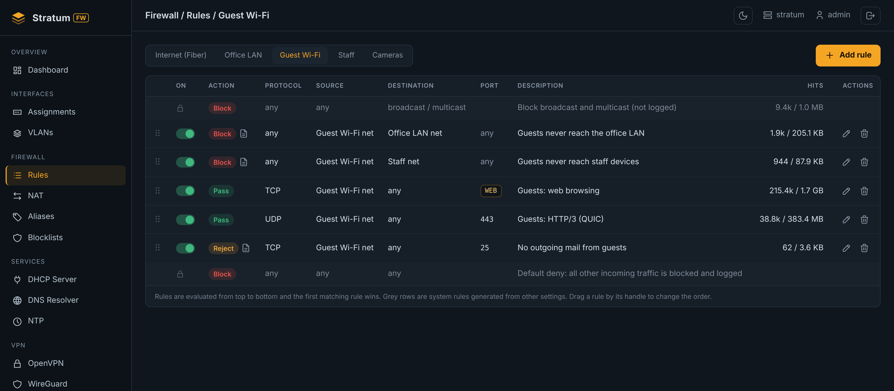
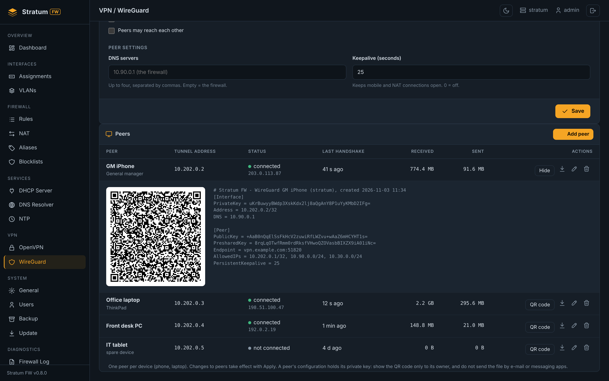
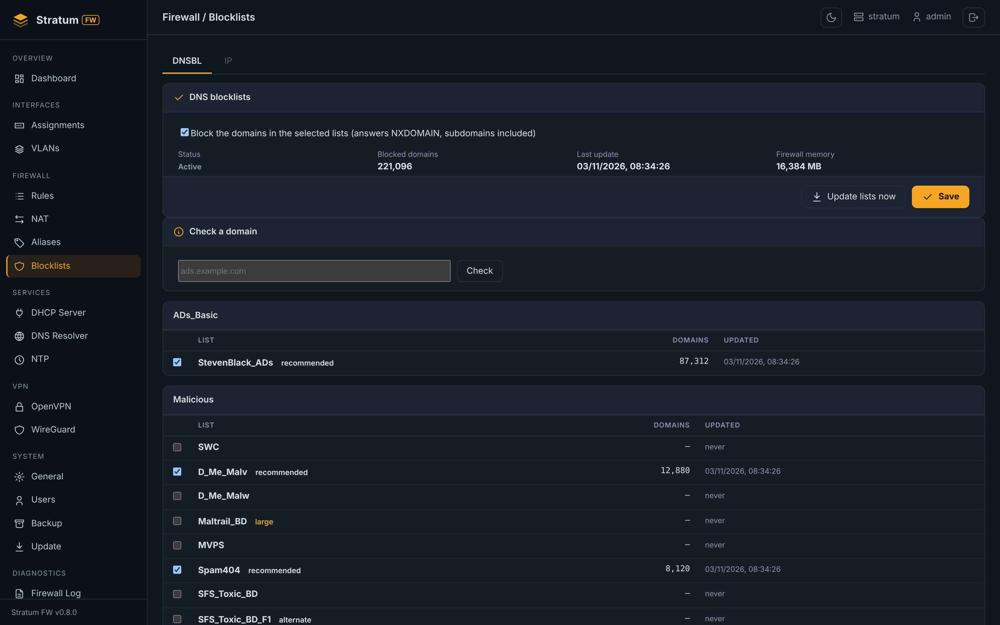

# Stratum FW

A self-hosted firewall and gateway appliance built on **FreeBSD 15.1** and **pf**, managed from a modern web
panel, in the spirit of pfSense and OPNsense. One configuration file, a safe apply with automatic rollback, and
signed updates with ZFS boot environments.

> **Repository status:** private. Current version **0.12.2** (November 2026). Release history:
> [CHANGELOG.md](CHANGELOG.md). Website and downloads: [stratumfw.com](https://stratumfw.com).


---

## Highlights

- **Safe apply.** Every change is validated, pre-checked (`pfctl -n`, `nginx -t`, `sshd -t`, `unbound-checkconf`,
  `dnsmasq --test`) and applied with an automatic rollback unless it is confirmed in time. Settings that would
  lock out the administrator are refused when saving.
- **One source of truth.** All settings live in one JSON file; pf, dnsmasq, Unbound, mpd5, OpenVPN, WireGuard,
  nginx, sshd and rc.conf are generated from it.
- **Signed updates.** Signed package repository, offline update files (`.sfu`), a backup and a new ZFS boot
  environment before every update; the previous version can be booted at any time.
- **No modal dialogs, no client-side build.** Server-rendered pages with small vanilla JavaScript modules, dark
  and light themes, usable on a phone.
- **Bilingual Interface (EN/TR).** Both the management panel and the official website fully support English and Turkish, with seamless language switching.

## Features

### Interfaces
- Interface assignments (WAN, LAN, OPT; OPT as WAN or LAN type), static / DHCP / PPPoE, gateway, MTU.
- 802.1Q VLANs, assignable like physical ports. An interface's description is shown as its name everywhere.

### Firewall and NAT
- Rules per interface with system rules shown, hit counters, drag-and-drop order, on/off switch.
- Aliases for hosts, networks and ports.
- Port forwards with automatic pass rules, outbound NAT (automatic, hybrid, manual), **NAT reflection**.
- Anti-lockout rule, bogon and private network blocking, IPv6 safety baseline (all IPv6 dropped until IPv6
  support arrives).
- **IP blocklists** (pf tables): 63 maintained IPv4 feeds derived from pfBlockerNG, own allow and block lists,
  hourly updates without Apply, "check an address".
- **DNS blocklists** (Unbound RPZ): pfBlockerNG and HaGeZi catalogues, own lists, nightly updates.

### Services
- DHCP server (dnsmasq) with static mappings and leases.
- DNS resolver: dnsmasq or Unbound (DNSSEC, forwarder or full recursion), host and domain overrides.
- NTP client and optional time service for internal networks.

### VPN
- **OpenVPN** remote access: built-in CA (EC keys, CRL, tls-crypt), certificate + password login, per-user
  profiles, fixed client addresses, access per LAN/VLAN, advanced settings (UDP/TCP, ciphers, TLS, DNS, MTU).
- **WireGuard** (FreeBSD kernel `if_wg`): peers with keys generated on the firewall, QR codes and `.conf`
  files, access per LAN/VLAN, live status; adding a peer does not disconnect the others.

### System
- **Settings** with tabs: General (hostname, domain, time zone, sign-in notice), Admin Access (panel port,
  management only from selected interfaces, WAN access with source addresses, sign-in protection, SSH and
  keys), Firewall & NAT (block policy, logging, state table, timeouts, SYN cookies, normalisation, NAT reflection,
  static port).
- Users and roles (administrator, operator, read-only), VPN-only accounts.
- Certificates: panel TLS certificate (view, upload your own, new self-signed, restore previous, expiry alert).
- Backup and restore with configuration history and differences.
- Software updates online or offline, with progress and rollback to the previous boot environment.

### Diagnostics
- Live firewall log with rule names, system logs, ping / traceroute / DNS lookup, pf state table, traffic
  graphs (1 hour, 24 hours, 30 days), dashboard with alerts.

### Console
- Console menu and first-boot setup wizard (interfaces, addresses, WAN access, time zone, administrator), reset
  of management access. Installer ISO in VGA and serial console variants (GPT, BIOS and UEFI, ZFS, offline).

## Screenshots

| | |
|---|---|
|  |  |
|  |  |

## Architecture

```
 Browser ──HTTPS──> nginx ──> uvicorn / FastAPI panel ──> config.json (+ users, keys, certificates)
                                                              │
                                   stratum-config apply ◄─────┘  validate · pre-check · snapshot
                                          │                         apply · confirm / automatic rollback
            ┌─────────────┬───────────────┼───────────────┬──────────────┬──────────────┐
          pf.conf    dnsmasq / Unbound   mpd5 (PPPoE)   OpenVPN / wg0   nginx / sshd    rc.conf
```

| Layer | Component |
|---|---|
| Operating system | FreeBSD 15.1 (amd64), ZFS, boot environments |
| Packet filter | pf (tables for blocklists, labels for counters) |
| Web panel | Python 3.12, FastAPI, Jinja2, Uvicorn behind nginx |
| Frontend | Server-rendered templates, vanilla JavaScript, no build step |
| Services | dnsmasq, Unbound, mpd5, OpenVPN, WireGuard (base system), ntpd |
| Packaging | FreeBSD `pkg`, signed repository, offline `.sfu` files |
| Command line | `stratum-config`, `stratum-menu`, `stratum-update`, `stratum-cert`, `stratum-ipbl`, `stratum-dnsbl` |

## Roadmap

- **0.12.3** Settings > Logging (retention, remote syslog) and Notifications (Telegram, e-mail).
- **0.12.4** Settings > Networking and Tunables (offloads, sysctl).
- Let's Encrypt certificates, routing (static routes, gateway monitoring, multi-WAN), dashboard redesign.
- IPv6 in phases: WAN with DHCPv6 prefix delegation, LAN and rules, services, VPNs.

## History

Earlier prototypes of this project ("Stratum Gateway") ran on Debian with nftables and systemd. Stratum FW is
the FreeBSD/pf rewrite that replaced them; the earlier code is kept in the `legacy-gateway` branch.

---

© 2026 Kaan Özkan. All rights reserved.

## 📰 Latest from Our Blog
* 🇹🇷 [pfSense Alternatifi Stratum FW: Yapay Zeka Destekli Yeni Nesil Güvenlik](https://stratumfw.com/tr/blog/pfsense-alternatifi-stratum-fw-mcp/)
* 🇬🇧 [Stratum FW vs pfSense: The AI-Powered (MCP) Next-Gen Firewall](https://stratumfw.com/blog/stratum-fw-vs-pfsense-mcp/)

## 📄 Changelog
For a detailed list of changes in every version, please visit our [Changelog Page](https://stratumfw.com/resources/changelog/) or check the [CHANGELOG.md](CHANGELOG.md) file.
